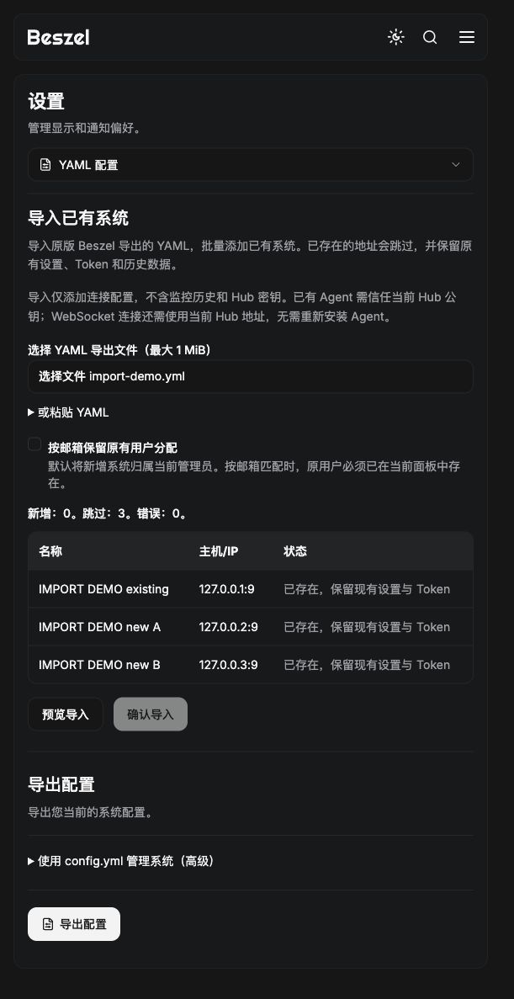
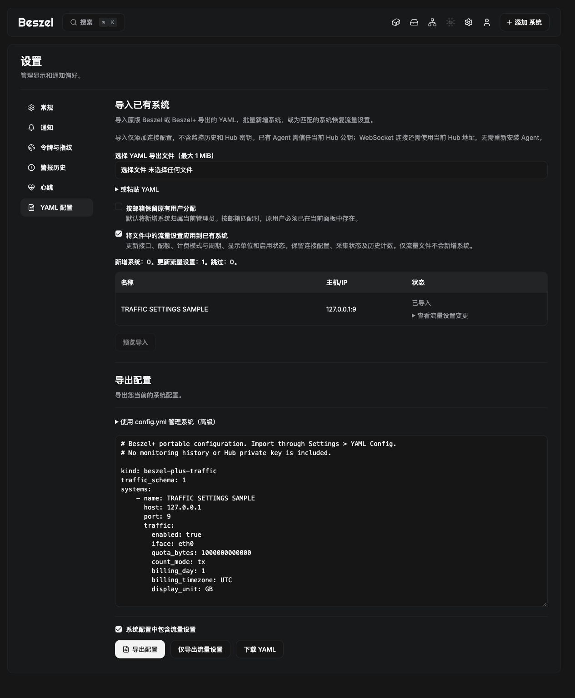

# 导入已有系统

Beszel+ 在“添加系统”中提供“从 YAML 导入已有系统”入口，也可直接打开“设置 → YAML 配置”。选择原版 Beszel 导出的 `.yml`、`.yaml`，或粘贴相同内容，预览后确认批量导入。扩展名为 `.md`、`.txt` 的纯 YAML 文件也可选择；Markdown 代码围栏不属于 YAML。

当前实现在 plus/main，独立本地预览为 `http://127.0.0.1:18091/settings/config`，版本 `0.21.1-plus.1-candidate.42217473195.1`，源码 `082cae8ed46597e1c29f731c488b848fd96cc24e`。[本轮公开候选](https://github.com/CodeAIX/Beszel-Plus/releases/tag/v0.21.1-plus.1-candidate.42217473195.1) 已包含一键导入、流量设置导入导出和七天离线缓存；18090 的候选版及其观察任务继续运行。

## 导入行为

- 仅管理员可预览和执行。每次最多 1 MiB、1000 个系统，支持原版的 name、host、port、token、users 字段及 Beszel+ 的带版本流量设置；端口缺省为 45876。
- 根据主机地址与端口去重，Unix socket 按路径去重；同一文件中的重复项也跳过。不会删除已有系统，不覆盖其名称、Token、用户、告警或历史数据；已有配额等流量设置仅在明确勾选并确认时更新。
- 新系统保留原 Token；缺省时生成新 Token，预览会提醒在 Agent 中配置。Token 被另一地址使用时整批阻止，避免连接到错误系统。
- 默认归属当前管理员。可选择按邮箱保留原用户分配；找不到用户时显示错误，不会静默丢弃授权。未提供用户列表时归属当前管理员。
- 有任何错误时不能确认；确认前重新验证文件、用户映射与重复状态。数据变化会要求重新核对预览。系统与 fingerprint 同一事务写入，任何保存失败整批回滚。
- 不写入 config.yml，也不调用原版的覆盖同步。若数据目录已经存在 config.yml，导入会阻止并提示先迁移该配置，避免下次启动同步删除新增系统。

API 为 `POST /api/beszel/config-yaml/import`；先提交 `config` 和 `user_mode`（current 或 match）获取预览，再以相同输入、`apply: true` 和 `preview_id` 确认。预览与错误响应不返回 Token；解析错误也不回显 YAML 内容。请求不进入 URL，响应标记 no-store。

## 已有 Agent 与迁移边界

原版“添加系统”会生成安装示例，但填写连接参数并不要求重新安装 Agent；原版也支持通用 Token 自动注册。原版 config.yml 在 Hub 启动时执行覆盖同步，未列出的系统会被删除，和本功能的增量导入不同。

YAML 导出只包含系统清单、地址、端口、Token 和用户邮箱，**不包含 Hub 私钥、监控历史、Agent 指纹、告警或 Beszel+ 流量配额**。因此：

- 在原 Hub 数据目录上升级 Beszel+，Hub 身份密钥沿用，已有 Agent 通常无需重新安装。
- 迁移到一个全新 Hub 时，只有导入 YAML 并不足以让原 Agent 自动信任它。SSH 需 Agent 的 KEY 信任当前 Hub 公钥；WebSocket 还需正确的 HUB_URL、TOKEN 与可达性。可修改现有 Docker Agent 环境变量并重新创建容器，保留 Agent 数据卷，无需先卸载 Agent。
- 本功能导入系统记录，不执行 VPS 安装或改配置，也不保证连接立即成功。需要完整保留原监控历史时应迁移/恢复完整 Hub 数据。
- 原版 Agent 导入后仍可做资源监控；流量日统计仍需宿主 vnStat、Plus Agent 及只读挂载，不能通过 YAML 自动补齐。

官方参考：[Agent 安装](https://beszel.dev/guide/agent-installation)、[认证机制](https://beszel.dev/guide/security)。

## 验证

新增 API 回归覆盖未登录/普通用户/只读用户拒绝、只预览不写入、原 Token 与 fingerprint/流量历史保留、重复文件/重复请求、用户邮箱映射、字段与 Token 冲突、失效预览、实际保存失败的整批回滚、文件大小/端口/未知字段/多文档限制和 config.yml 防护。Hub 与 config 包 race 回归通过；前端 33 项测试和生产构建通过。

用户提供的本地导出文件已仅通过预览检查：10 个系统均可解析，未创建系统或发起远程连接，真实文件及 Token 未加入仓库。浏览器使用独立实例与回环地址样例完成粘贴预览、确认新增 2 台/跳过 1 台、文件选择后重复导入全部跳过的验证。

首版基础导入的 [GitHub 完整回归 42192569636](https://github.com/CodeAIX/Beszel-Plus/actions/runs/42192569636) 的 Agent、Web/Hub 两项任务均成功；对应功能源码 `04f2350c549515b0b7424a32063d939d7a3c8046`，当时本机预览镜像标注同一源码。此段记录首版验收；三项功能现已随本轮公开候选合并发布。

## 流量设置单独及联合导入导出

“设置 → YAML 配置”可选择：

1. 默认勾选“系统配置中包含流量设置”，导出 Beszel+ 联合格式，含原连接配置与各系统已有的流量设置。
2. 取消勾选，导出原版兼容格式。
3. 点击“仅导出流量设置”，导出不含 Token、用户分配的独立文件。此格式只含已有流量设置的系统，以 host+port（Unix socket 为路径）匹配目标系统；未配置任何流量设置时文件中的 systems 为空，没有可恢复的条目。

导出后可直接下载 YAML。联合格式使用 kind: beszel-plus-config，独立格式使用 kind: beszel-plus-traffic，两者使用 traffic_schema: 1。每条 traffic 仅包含 enabled、iface、quota_bytes、count_mode、billing_day、billing_timezone、display_unit。配额以精确整数字节保存；不导出/导入累计流量、collector 状态、来源时间戳、系统数据库 ID 或 Hub 私钥。

导入联合文件时，新系统同时保存其流量设置；已有系统默认全部保留。明确勾选“将文件中的流量设置应用到已有系统”后，才会更新已有系统的七项流量配置，连接信息、Token、用户和历史不变。独立文件无论如何都不新增系统；找不到对应地址、同一地址对应多个已有系统、文件重复指定流量设置或参数越界时整批阻止。未知版本/未知保护字段拒绝解析。

预览可展开查看当前与导入后的七项设置。配额同时展示可读单位和精确字节；确认前会重新读取现有配置，期间有人修改则拒绝旧预览并要求核对。所有新增/设置变更同一事务落库，设置保存失败也会回滚已创建系统和 fingerprint。只覆盖人工字段，保留已有 collector 元信息。

可在 Agent 首次上报前恢复网络接口与配额；接口存在性要等实际采集后确认。恢复配置并不安装 vnStat、升级 Agent 或填充历史流量。

断线采样与补传的现状和方案见 [OFFLINE_HISTORY](OFFLINE_HISTORY.md)。已实现每分钟采样、最近 7 天的 Agent 持久化缓存及恢复补传；需要升级 Plus Agent 并保留数据卷。本地与 [GitHub CI](https://github.com/CodeAIX/Beszel-Plus/actions/runs/42214559483) 均已通过，三项功能现已合并发布，镜像与更新方式见 [当前候选](traffic/CANDIDATE.md) 和 [更新指南](UPGRADE.md)。

本轮流量设置功能源码 `d80e39bed956777656ebba100a4a997851bf4da5`，对应 [GitHub 回归 42198360686](https://github.com/CodeAIX/Beszel-Plus/actions/runs/42198360686) 的 Agent、Web/Hub 任务全绿。本地 Hub/config 包 race 回归、vnStat 三日断线补齐测试、前端 33 项测试及生产构建通过。

浏览器在独立样例实例验证：默认不覆盖、明确勾选后预览 20GB → 1TB / 双向 → 仅出站 / 起始日15 → 1、确认更新、单独导出及下载。下载文件与服务端导出逐字一致。真实预览 18091 已升级并保留原来的 10 台系统、身份密钥、地址与用户授权，未为其写入测试配额。

