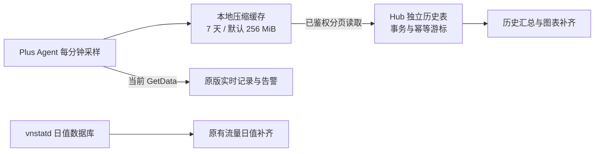
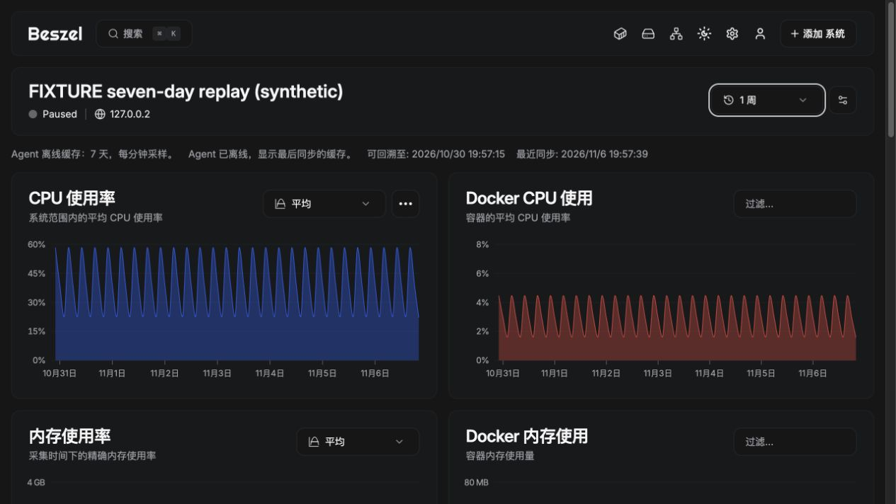

# 七天离线缓存与恢复补传

用户于 2026-11-06 选择最近 **7 天、每分钟一个样本**。Plus Agent 与 Hub 已实现缓存、分页补传和图表集成，本地与 GitHub CI 验证已通过，尚未发布新公共镜像。公开候选 `0.21.1-plus.1-candidate.42181555701.1` 尚不含本功能；仅升级 Hub 不会让原版 Agent 产生历史缓存。

## 使用行为

| 情况 | CPU、内存、磁盘、Docker 等资源指标 | vnStat 日流量 |
|---|---|---|
| Hub 停机或连接中断，Plus Agent 与 VPS 正常 | Agent 持续采样落盘；Hub 重连后在后台补传，保留真实采样时间 | 宿主 vnstatd 继续计数；重连读取其保留的日绝对值并幂等补齐 |
| Agent 重启，数据卷保留 | 已落盘的缓存保留，启动后继续采样；停机时段无样本 | vnstatd 独立正常运行时仍可计数 |
| VPS 停机、Agent 未运行、磁盘故障或尚未启用本功能 | 无法恢复未采集/未保存的内容，不生成假的零值 | 不承诺恢复未保存的日值，缺失日期保持不完整 |
| Hub 离线超过 7 天或缓存容量不足 | 仅补回仍被保留的样本，页面显示可回溯时间和不完整提示 | 由 vnStat 的 DailyDays、数据库与当前最多 400 日的协议限制决定 |

缓存资源快照包含 CPU、内存/交换区、磁盘/IO、网络速率、负载、原有传感器/GPU/电池及 Docker 指标（以该 Agent 实际可采集内容为准）。系统详情、服务当前状态、网络探测结果、日志、通知不作为资源历史重放；这些仍沿用原版实时语义。

历史补传仅用于图表，不会改变当前在线状态，也不会让过去的高 CPU 等样本触发当前告警。vnStat 流量仍使用独立日值机制，不从网络速率历史积分计算账单。

## Agent 持久化与容量

默认启用，目录为现有 Agent 数据卷中的 `/var/lib/beszel-agent/history-v1/`。沿用原 `/var/lib/beszel-agent` 持久卷和原 KEY/TOKEN/HUB_URL；更换 Agent 镜像时保留该数据卷。缓存不是存放在临时容器层内。

可通过环境变量配置：

```yaml
environment:
  BESZEL_HISTORY_ENABLED: "true"
  BESZEL_HISTORY_MAX_BYTES: "268435456"
```

- 固定保留目标为最近 7 天，每个 UTC 分钟最多保存一个实际资源快照。启用之前的普通监控缺口不能补造。
- 默认压缩文件容量上限为 256 MiB，可设置 8 MiB–1 GiB；时间或容量条件先达到时淘汰最旧样本。大量容器/传感器可能缩短实际可回溯范围，页面不会把目标 7 天当作完整覆盖保证。
- 每个样本最多 256 KiB 解压内容，写入后台有界队列；临时文件、同步落盘和原子重命名保护已保存样本。缓存写入异常不阻塞当前监控响应。
- 文件逐条压缩并校验，坏记录可跳过，后续记录继续补传；时钟回退不把旧时间伪装为新样本。缓存容量截断标记跨 Agent 重启保留。
- 关闭缓存可使用 `BESZEL_HISTORY_ENABLED: "false"`。Hub 暂停监控或断连不会关闭 Agent 的自主采样；恢复监控后仍可读取保留窗口内的数据。

## Hub 接收与图表

通过已鉴权的 SSH/WebSocket 通道分页读取，每页最多 128 个样本且不超过 1 MiB；不新增 Agent 公网接口。Hub 最多同时为两个系统后台同步，长任务按轮次续传；每个 Hub 独立保存游标，任何 Hub 的确认都不会删除 Agent 缓存。

`agent_history_state` 保存进度与覆盖诊断，`agent_history_records` 保存独立历史与 1m/10m/20m/120m/480m 图表层级。样本、受影响的汇总桶和游标在同一事务落库；失败后下次重试，不重复累加。旧的 system_stats/container_stats 和实时告警流程保持独立。

Hub 原始样本保留目标为 7 天，额外原始数据容量也限制为每系统 256 MiB；汇总层级按原版对应的 12 小时、24 小时、7 天、30 天保留。每小时清理过期内容，永久离线系统也会被清理。数据删除系统时按关系级联清理。

页面重读所选范围的历史桶，使补传的旧时间点也能出现，而不是只追加最新时间点。完整恢复桶用于该时间段的图表；部分恢复桶只填空缺，不覆盖已有实时/官方汇总。缺失时保留断线，不填零。界面显示缓存目标、实际可回溯起点、最近同步、补传中、未启用或不完整等状态。



## 兼容与验证

协议只追加 CombinedData key 8 和 GetHistory action 10，原有 key 0–7 和 action 0–9 不变。旧 Agent 继续提供原监控；新 Agent 面向旧 Hub 仍返回兼容数据。上游自动维护在 key 7/8 或 action 布局被占用/改变时停止，要求人工迁移，避免静默冲突。

已验证：

- 七天过期、跨重启分页读取、独立 Hub 读取不消耗缓存、按分钟去重、时钟回退、容量上限与截断标记持久化、损坏记录继续读取、符号链接隔离、有界并发和大样本分页。
- 六天前的 480 条分钟样本生成完整周/月汇总，重复重放不增行，近期样本生成其余层级；原始样本过期后长期汇总仍可查看。
- 保存失败时原始样本、汇总和游标共同回滚；补传不写入原实时统计表、不改当前系统状态或发起告警；迁移反复回滚/重建不影响原记录。
- 认证、成员/readonly 读取权限，禁止通过客户端伪造历史；旧响应形状与原 action 序号兼容。CPU 每核数组、电池元组兼容 JSON v1/v2 回读及旧字节字符串。
- 独立 Docker 实测：Hub 停机约 195 秒，Agent 期间重启；3 条真实离线分钟样本（含 Docker）按原时间恢复，另补回 1 条停机前尚未确认的样本；再次重启 Hub 不重复。普通 system_stats 在停机区间确实为空，图表恢复来自独立补传数据。

7 天边界与旧日期场景使用受控时间/样例验证；真实断线实测为上述约 195 秒，不宣称已经连续运行或停机实测 7 天。本机整包 `go test -race -tags=testing -p 2 -timeout 20m ./...`、前端 38 项回归、TypeScript 与生产构建通过。独立样例的 10,080 条七天分钟数据及全部图表层级成功入库，周图可同时展示系统与 Docker 历史；此压力样例不代表真实连续运行七天。[GitHub 回归 42214559483](https://github.com/CodeAIX/Beszel-Plus/actions/runs/42214559483) 的 Agent 与 Web/Hub 两项任务均成功，包含 Linux amd64/arm64 Agent 构建和新增缓存模块的竞态回归。完整下游补丁已对固定上游重新执行 `git apply --check`，发布清单包含新迁移与协议版本。本轮未修改 fnOS 或生产 VPS 的 Agent。

流量设置的单独与联合导入导出见 [IMPORT_SYSTEMS](IMPORT_SYSTEMS.md)；YAML 设置文件不携带本地缓存或全部监控历史，迁移完整 Hub 数据仍需完整数据目录备份。



## 本轮交付与预览

功能源码 `23d275f81c6e4cdf7ee67f9d0048e5c89d26196b`，本地 Hub/Agent 测试镜像版本 `0.21.1-plus.1-history.2-local`。主预览 `http://127.0.0.1:18091` 已升级；升级前完整备份数据目录，之后确认原有 10 台 VPS 全部在线，系统地址、名称、授权、Hub 身份密钥、Agent 指纹/Token 和人工流量设置保持一致。未向该预览注入任何测试系统或测试配额。

隔离实例 `http://127.0.0.1:18093` 用于 Plus Agent 与 Hub 的真实断线测试及明确标注的七天模拟图表。最终同一源码构建的两个容器重新创建后，既有缓存文件内容保持一致，新样本可继续同步。18090 的旧候选及其观察任务未切换，旧候选的观察结果不代表本次新增功能已经连续验收。

既有 Docker Agent 获得本功能时需使用包含上述源码的 Plus Agent，并保留其原数据卷，例如原 Compose 应继续包含：

```yaml
services:
  beszel-agent:
    # 使用之后发布并验证过的新 Plus Agent 版本；旧候选不含七天缓存。
    volumes:
      - ./beszel_agent_data:/var/lib/beszel-agent
    environment:
      BESZEL_HISTORY_ENABLED: "true"
      BESZEL_HISTORY_MAX_BYTES: "268435456"
```

此处仅展示缓存相关片段。沿用部署中已有的卷路径、KEY/TOKEN/HUB_URL、网络与 Docker socket 配置，合并片段时保留原有挂载和环境变量；不要换成空数据卷。本轮未升级真实 VPS 的 Agent。公共镜像的正式发布与部署记录应在实际发布后补充，不能用本地镜像标签代替公共版本。
