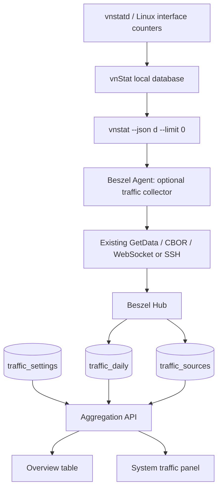

# Beszel Plus｜vnStat 流量统计原生集成开发规格（v1.0）

> **交付对象**：Codex / GitHub 开发 Agent  
> **制定日期**：2026-11-05  
> **实施基线**：`henrygd/beszel` **v0.21.1**（2026-10-22 发布）  
> **实施方式**：Fork 后增量开发；保留 Beszel 原有 Hub + Agent + React/PocketBase 架构。  
> **目标环境**：Ubuntu 24.04、Debian 12/13 Linux VPS；优先支持原生/systemd Agent。  
> **状态**：设计规格，**不是已完成代码**。所有接口/表名中以 `traffic_*` 开头且标记为“拟新增”的部分，均需 Codex 实施。  
> **版本策略**：开发时 pin 到上游 tag `v0.21.1` 与对应提交 SHA；不要从滚动 `main` 直接开工。Fork 自身版本用 `0.21.1-plus.1`（如版本比较存在限制，则将自定义构建标识独立存放）。

---

## 0. 给 Codex 的不可违反约束

**优先级 P0：控制改动范围；先调研再编码；每阶段提交，禁止一把梭重构。**

1. 先检查仓库、tag、Go module、现有测试、PocketBase migration 机制、Agent→Hub 路径；输出 `docs/traffic/IMPLEMENTATION_MAP.md` 和实际文件清单，再写代码。若本规格所列路径与当前仓库不符，**以实际 v0.21.1 源码为准，注明差异，勿凭猜测硬改**。
2. 只做 vnStat **独立进程/CLI JSON 查询**，**不修改或复制 vnStat 源码**；Agent 不读取/篡改 vnStat SQLite 数据库，不以抓包、eBPF、iptables/nftables 计数器替代 vnStat。
3. 不修改原 `system_stats` / `container_stats` 语义，不修改 `Stats.Bandwidth` 或 `Stats.NetworkInterfaces` 的计量逻辑；新数据进独立集合。
4. 不新增公网可调用的 Agent 接口、不暴露 vnStat TCP 服务、不新增供外部 Agent POST 的未鉴权数据入口；复用 **既有 GetData 请求及 Agent→Hub 连接**。
5. 对现有 CBOR 协议只能**追加唯一新字段编号**，禁止重排已有字段编号和 `WebSocketAction` 枚举常量。旧 Agent、新 Agent的混合版本必须能运行原监控功能。
6. **交通/流量功能出错不能使原有 CPU/内存/磁盘/离线监控失效**。新增统计写库失败须单独记录错误并可重试；不能使现有 `createRecords` 整体回滚。
7. Agent 只以最小权限运行、禁用 shell 拼接、禁止前端传命令参数、限定执行超时和 JSON 大小；任何字符串类型的接口名称仅作为普通数据使用。
8. 所有新表遵循 Beszel `systems.users` 成员权限和 `SHARE_ALL_SYSTEMS` 规则；readonly 只能看不能改；客户端不得直接伪造统计数值或更改归属关系。
9. 不修改现有安装器的自动更新目标为自定义 Fork，除非具备明确、已测试的版本验证和回滚机制。初版默认禁用自动替换二进制文件的升级流程，发布固定版本。
10. **按阶段交付**，每个阶段完成后提交 commit、运行对应测试、写总结，再进入下一阶段。禁止无任务驱动修改全局主题、翻译体系、数据模型、监控协议其他部分或现有历史数据压缩逻辑。

### P0「必须完成」范围

- Linux Agent 可选启用读取 `vnstat --json` 的按日流量；缺失 vnStat 时优雅降级。
- 复用 Beszel GetData 响应附带可选 `Traffic` 数据；Hub 独立持久化、去重且不阻碍原监控。
- 每台 VPS 选择**一个**计费网络接口；显示当日/当月/当前账单周期的 Rx、Tx、合计与配额使用率。
- 多 VPS 总览一处查看当月用量；单 VPS 详情页展示日流量柱状图及配置；支持自定义**账单起始日 1–28 日**。
- 统计的时间粒度为**日**，首版统一使用 **UTC 日界线**（见时区限制）；区分“已覆盖完整周期”和“不完整/尚无数据”。
- 测试、备份/恢复、单机灰度升级、回滚文档。

### P1「下一阶段」范围（P0 验收后独立实施）

- 按每台 VPS 的 80%/90%/100% 配额触发**去重**告警，复用现有通知渠道与静默时段；多用户授权规则。
- 日/月报表与按日期范围汇总、导出 CSV（不承诺超过已有数据覆盖范围）。
- 原生 Docker Agent 访问宿主 vnStat 的可选、受控部署路径；恢复/迁移后的重建工具。

### P2「后续评估；P0 不做」

- 精确至小时或分钟的账单时间、每月 29–31 日特殊账单日、不同于 vnStat 日期基准的云厂商时区。
- 复杂的多物理网卡计费合并、网卡更名连续性迁移、云厂商 API 账单对账。
- vnstati 图像嵌入、复杂流量预测、支持 FreeBSD/macOS/Windows 的替代采集器。

---

## 1. 产品目标与明确非目标

### 1.1 目标

原版 Beszel 对 CPU、内存、磁盘、实时网络速率、Docker 和通知保持原样；新增一个**可信、可追踪覆盖范围的流量计量模块**：

- 以 `vnstatd` 在 VPS 本地形成的日流量为唯一统计真源。
- Hub 是跨 VPS 的**汇总/展示与长期保存**真源；Hub 持久化日记录后，不受 Agent 端历史保留窗口限制。
- 在 Home 系统列表添加“本账单期已用”列，支持 `Tx`/`Rx+Tx` 统计模式、容量、百分比、状态；避免逐行触发 N 次请求。
- 系统详情新增 `Traffic` 区块或标签：今日、自然月、当前账单周期、过去 30/90 天历史，显示原始字节量和最近数据时间。
- 任一系统还未安装 vnStat 或版本不支持，UI 提示可操作的诊断信息，仍正常显示原监控。

### 1.2 非目标 / 必须警告

- Beszel Plus 不是阿里云、Oracle、Raksmart 的**官方计费账单**；部分厂商按公网出站计费，可能排除专网流量或有计费粒度差异。
- **不得把 `tailscale0`、`docker0` 和 `eth0/ens3` 简单相加。** 这些接口可能记录同一笔已封装/转发流量。
- `vnstat` 统计从其数据库存在的时点开始；安装前无法恢复未采集的历史数据。
- Agent 离线超过 vnStat 本地 `DailyDays` 保留窗口，期间缺失的旧日数据无法保证补齐；UI 必须标记“不完整”，不可虚构 0 流量。
- UTC 日边界下的“账单日 15 日”是 UTC 00:00，不等于 Asia/Shanghai 15 日 00:00。首版不承诺后者精度。
- 只统计**服务器网卡层** Rx/Tx；不做每个代理节点、用户或 Tailscale peer 的细分计费。

---

## 2. 源码基线与需要修改的文件清单

本清单已按上游 `v0.21.1` 的实际目录核对；**左侧 Existing 表示现存文件，New 表示建议新增文件**。每个现存文件尽量只增加小范围代码。

| 模块 | 路径 | 状态 | 允许的变更 |
|---|---|---|---|
| 共享数据结构 | `internal/entities/system/system.go` | Existing | 仅在 `CombinedData` 追加可选 `Traffic` 字段，分配未用 CBOR key `7`；不动 `Stats` |
| 共享类型 | `internal/entities/traffic/traffic.go` | **New** | 定义 `Snapshot`, `InterfaceDaily`, `DailyBucket`, `Status`；输入范围及字段约束 |
| Agent 入口 | `agent/agent.go` | Existing | 增加 collector 生命周期/可选采集调用；不得改原指标收集逻辑 |
| Agent 采集 | `agent/traffic_vnstat.go` | **New** | 执行受限 vnStat CLI、JSON 解码、缓存、状态码；无第三方特权依赖 |
| Agent Linux | `agent/traffic_vnstat_linux.go` | **New** | Linux 启用函数（编译标签）；本机可执行文件查找 |
| Agent 其他平台 | `agent/traffic_vnstat_unsupported.go` | **New** | 非 Linux 空实现，不影响原平台构建 |
| Hub 更新路径 | `internal/hub/systems/system.go` | Existing | 原 `createRecords(data)` **成功后**条件调用独立 `saveTrafficSnapshot`；失败只记录日志 |
| Hub 落库 | `internal/hub/systems/traffic.go` | **New** | 按 `(system, iface, day)` 幂等 upsert、来源状态更新、字段验证、事务 |
| 数据迁移 | `internal/migrations/<new_unique_timestamp>_traffic.go` | **New** | 创建 3 个 `traffic_*` collection、索引、合理回滚；不碰快照 migration |
| 访问规则 | `internal/hub/collections.go` | Existing | 添加新表授权规则；允许 Hub 写、前端读，设置表仅经自定义接口改 |
| Hub API 路由 | `internal/hub/api.go` | Existing | 仅登记新 API，重计算/校验在独立文件 |
| Hub API 实现 | `internal/hub/traffic_api.go` | **New** | Overview/Detail/Settings；鉴权、范围校验、聚合与完整性标记 |
| Hub 业务计算 | `internal/hub/traffic_calc.go` | **New** | 账单周期、求和、配额模式、数据覆盖率，保持纯函数可单测 |
| TS 类型 | `internal/site/src/types.d.ts` | Existing | 添加流量响应/设置 TypeScript 类型 |
| Web API | `internal/site/src/lib/traffic-api.ts` | **New** | 统一获取/更新封装，缓存与错误状态 |
| Web 总览 | `internal/site/src/components/systems-table/systems-table.tsx` | Existing | 页面级**一次**请求所有可见 VPS 的流量摘要 |
| Web 列定义 | `internal/site/src/components/systems-table/systems-table-columns.tsx` | Existing | 插入可隐藏的“本期流量”列，沿用表格风格 |
| Web 系统详情 | `internal/site/src/components/routes/system.tsx` | Existing | 只增加 Traffic 面板/标签入口，不改旧图表 |
| Web 详情面板 | `internal/site/src/components/routes/system/traffic-panel.tsx` | **New** | 今日、当月、账单周期、覆盖率、日柱状图 |
| Web 设置弹窗 | `internal/site/src/components/traffic/traffic-settings-dialog.tsx` | **New** | 接口、配额、模式、起始日设置；readonly 禁止修改 |
| Web 共享展示 | `internal/site/src/components/traffic/traffic-usage-cell.tsx` | **New** | 进度条/单位/状态复用 |
| Agent 测试 | `agent/traffic_vnstat_test.go`, `agent/test-data/vnstat/*.json` | **New** | 标准/异常 JSON，执行超时、状态 |
| Hub 测试 | `internal/hub/systems/traffic_test.go`, `internal/hub/traffic_api_test.go`, `internal/hub/traffic_calc_test.go` | **New** | 幂等、API 鉴权、账单日、覆盖率 |
| 前端测试 | `internal/site/src/lib/traffic-api.test.ts` 等 | **New** | 类型/金额/日期显示与错误状态 |
| 运维文档 | `docs/traffic/README.md`, `docs/traffic/OPERATIONS.md`, `docs/traffic/IMPLEMENTATION_MAP.md` | **New** | 安装、升级、回滚、边界与源码映射 |

**不要修改的热点**：`agent/network.go`、`internal/records/records.go`、`internal/records/records_deletion.go`、既有 `network-sheet.tsx`、`internal/common/common-ws.go` 的动作常量顺序、现有历史采样/降采样流程、已有 migration 快照、原有 Docker 数据采集。

**路径/版本核查点**：`agent/agent.go:gatherStats()`，`internal/entities/system/system.go:CombinedData`，`internal/hub/systems/system.go:update()` 和 `createRecords()`，`internal/hub/api.go:registerApiRoutes()`，`internal/hub/collections.go:setCollectionAuthSettings()`，`internal/site/src/components/systems-table/*`，`internal/site/src/components/routes/system.tsx`。

---

## 3. 总体架构及采集流程



### 3.1 采集原则

- 默认关闭，通过 `BESZEL_TRAFFIC_ENABLED=true` 显式启用（未来稳定后可再评估默认开启）。
- `BESZEL_TRAFFIC_REFRESH=5m`，最小允许 1m，建议默认 5m；与 Hub 现有每分钟系统状态轮询**分离**。同一轮询可能重复携带缓存快照；Hub 必须幂等。
- Linux 执行：`vnstat --json d --limit 0`，从当前 vnStat 已监控接口取得所有可用日记录。**首日 bootstrap 获取本地仍保留的历史天数**；正常轮询仍复用同一命令，避免仅拉最新一天造成跨日漏报。
- 运行前必须在目标 VPS 验证 `vnstat --json d --limit 0` 的实际输出结构；命令参数由程序固定定义，绝不拼 `sh -c`。
- Agent 初始化和周期性（例如 1 小时）读取只读命令 `vnstat --showconfig`，核验有效配置中的 `UseUTC 1`（vnStat 默认通常为 `UseUTC 0`）。无法验证时报告 `unsupported_timebase`，**不得仅凭环境变量声称数据属于 UTC 日**。此校验只读取，不自动更改配置；保留实际版本的 CLI 行为测试。
- 子进程超时 **3 秒**；stdout 上限 **256 KiB**、最多 **16 个接口 × 每接口 400 日记录**（如确有更大保留配置，由设置明确调整上限）；限额触发时置 `payload_too_large`，不能截断成“合法 JSON”继续上报。
- 允许首次查询结果为空、版本未安装或权限不足，报告**结构化状态码**，不影响原监控。日志不打印 JSON 全量内容或敏感环境变量。
- 各条时间记录为 vnStat 已累计的**当日绝对值**，不是相邻请求间的增量；Hub 按日 upsert **替换**，严禁对同一天的重复上报累加。

### 3.2 Agent 环境变量（拟新增）

| 变量 | 默认值 | 约束 |
|---|---|---|
| `BESZEL_TRAFFIC_ENABLED` | `false` | true / false；仅 Linux 有实际采集能力 |
| `BESZEL_TRAFFIC_REFRESH` | `5m` | 1m–1h；错误配置回退 5m 并日志告警 |
| `BESZEL_TRAFFIC_VNSTAT_PATH` | 自动 `exec.LookPath("vnstat")` | 如显式设置必须是绝对路径、可执行文件；禁止任意命令行参数 |
| `BESZEL_TRAFFIC_TIMEBASE` | `utc` | **P0 只接受 `utc`**；要求管理员验证主机 vnStat `UseUTC 1` |

**重要**：`BESZEL_TRAFFIC_TIMEBASE=utc` 仅用于声明所需时间基准，不能替代 `vnstat --showconfig` 的有效配置核验。Agent 不自动编辑 `/etc/vnstat.conf`、不修改 `MonthRotate`、不重启 `vnstatd`。对已有 vnStat 数据库切换 `UseUTC` 前应备份，并在运维文档中给出影响提示；P0 的 `UseUTC 1` 是部署前置条件，不是静默自动修复。

### 3.3 Linux 安装/预检流程

```bash
# 先确认原版 Beszel 已能正常监控，随后在 VPS 执行：
sudo apt update
sudo apt install -y vnstat
sudo systemctl enable --now vnstat

# 确认 vnStat 版本、已采集网卡、JSON 能读取
vnstat --version
vnstat --dbiflist
vnstat --showconfig | grep -E "^(UseUTC|MonthRotate|DailyDays|TrafficlessEntries)"
vnstat --json d --limit 0 | head -c 300
ip -brief link

# 查看配置；确保与 P0 UTC 时间基准一致。
grep -E '^[[:space:]]*(UseUTC|MonthRotate|DailyDays|TrafficlessEntries)' /etc/vnstat.conf || true
```

不提供自动强改 `UseUTC` 的脚本；保留用户确认、备份、修改、重启与重新观察数据的人工步骤。若主机配置或权限不符合 P0，UI 显示“需要配置/未验证”，**不把计量值冒充可信结果**。

### 3.4 安全与部署权限

- Beszel Agent 使用原 systemd 服务账号即可；通过 `sudo -u <agent-user> vnstat --json d --limit 0` 测试读取权限；**不得因为此功能把 Agent 改为 root**。
- vnStat 由 OS 服务维护自己的数据库；Agent 不需要原始网卡捕获权限、NET_ADMIN 或额外 CAP_*。
- Web 接口选择作用于 Hub 聚合，不向 Agent 注入 Shell 参数；存储的网卡名称仅用于筛选已上报接口。
- Docker 版 Agent 的 P0 行为为功能不可用或需要指定经过验证的受限挂载/桥接；**不能假设容器有宿主 vnStat 二进制与数据库**。Docker 原生集成列入 P1。

---

## 4. Agent→Hub 数据通信规范

### 4.1 共享模型（拟新增）

建议在 `internal/entities/traffic/traffic.go` 定义与下述语义等价的 Go 类型（字段名可依据实际风格微调；一旦确定要锁定序列化契约）：

```go
// 示意：请依 v0.21.1 使用的 CBOR 库和 omitempty 规范落实。
type DailyBucket struct {
    Day     string `json:"day" cbor:"0,keyasint"` // YYYY-MM-DD, UTC date
    RxBytes uint64 `json:"rx"  cbor:"1,keyasint"`
    TxBytes uint64 `json:"tx"  cbor:"2,keyasint"`
}
type InterfaceDaily struct {
    Name string        `json:"name" cbor:"0,keyasint"`
    Days []DailyBucket `json:"days" cbor:"1,keyasint"`
}
type Snapshot struct {
    SchemaVersion uint8            `json:"v" cbor:"0,keyasint"` // start at 1
    Status        string           `json:"status" cbor:"1,keyasint"`
    ObservedAt    int64            `json:"observed_at" cbor:"2,keyasint"` // UNIX seconds UTC
    Timebase      string           `json:"timebase" cbor:"3,keyasint"` // P0: utc
    Interfaces    []InterfaceDaily `json:"interfaces,omitempty" cbor:"4,keyasint,omitempty"`
    ErrorCode     string           `json:"error_code,omitempty" cbor:"5,keyasint,omitempty"`
}
```

`Status` 最少：`ok`, `disabled`, `vnstat_missing`, `no_database`, `no_interfaces`, `unsupported_timebase`, `exec_timeout`, `invalid_json`, `permission_denied`, `payload_too_large`。错误码不包含 CLI stderr 原文。`ObservedAt` 为**采样观察时间**，不等于 vnStatd 最后保存时间；若可稳定解析接口 `updated` 字段，则增加独立 `SourceUpdatedAt`，用于显示真实数据新鲜度。不可把观察时间当作保存时间。

### 4.2 对现有结构的唯一协议变更

在 `internal/entities/system/system.go`：

```go
// 在 CombinedData 最后追加；勿修改既有 cbor 0..6 编号。
Traffic *traffic.Snapshot `json:"traffic,omitempty" cbor:"7,keyasint,omitempty"`
```

- Hub v0.21.1 + 旧 Agent：`Traffic == nil`，原功能必须 100% 正常。
- 新 Agent + 支持扩展的 Hub：增加 Traffic，既有 Stats/Info/Containers 仍按原结构工作。
- **新 Agent + 未改造的旧 Hub 并不自动视为已验证兼容**：需运行混合版本集成测试（特别是旧版 CBOR 对未知 key 的行为）；生产升级顺序固定 **Hub 先、Agent 后**。
- 既有 `internal/common/common-ws.go` 中 `GetData` 的枚举值不变，无需新增 websocket action；Agent 仍走 `agent/handlers.go:GetDataHandler` → `agent/agent.go:gatherStats`。
- 如存在 SSH fallback：验证通道会正确解码可选字段；不能只测 WebSocket。

### 4.3 失败时的行为

- CLI 超时/命令缺失：仍返回常规 GetData；`Traffic.Status` 为对应错误，不传播为整个 GetData 失败。
- Hub 无 Traffic：旧 Agent 显示“未启用/版本不支持”；Hub 不擅自把上一次成功值当成当前准确值。
- 有上次成功数据但本次失败：保留数据库历史；摘要展示**上次成功数据及明确的 stale 标识**，不得显示“实时同步成功”。
- Hub 日数据写入失败：单独日志与指标；保存原有系统记录；下次 Agent 再发送缓存/刷新后的**绝对日数据**，实现重试补齐。

---

## 5. PocketBase 数据库设计（拟新增）

采用**三张独立基础集合**，与原版 `system_stats` / `container_stats` 完全隔离。通过 PocketBase migration 创建，不用手工改生产 SQLite。

### 5.1 `traffic_sources`：来源/状态

**粒度**：一台系统 × 一个网卡；唯一键 `(system, iface)`。

| 字段 | 建议类型 | 说明 |
|---|---|---|
| `system` | relation → `systems`（required, cascade） | 服务器 ID |
| `iface` | text required | 例如 eth0、ens3 |
| `collector` | text | 固定 `vnstat` |
| `schema_version` | number integer | 当前 1 |
| `timebase` | text | P0 固定 utc |
| `status` | select/text | ok、stale、error 等（限制值） |
| `error_code` | text | 结构化错误代码 |
| `first_seen_at` | date | 第一次同步 |
| `last_observed_at` | date | 最后采集请求时间 |
| `last_success_at` | date | 最后成功同步时间 |
| `first_available_day` | text | 已知最早日记录 |
| `last_available_day` | text | 已知最晚日记录 |

`status` 是采集状态，不代表“统计的账单周期完整”。当命令失败且尚未发现任何接口时，**不得伪造 `iface="eth0"`，也不创建假网卡**。为避免额外第四张表，P0 应将机器级状态保存到下述 `traffic_settings` 的只读系统字段 `collector_status`、`collector_error_code`、`collector_last_observed_at`、`collector_last_success_at` 中；首次接收到 Traffic（即使为失败状态）时，Hub 自动创建一条默认 settings 记录。UI 设置 API 只能编辑白名单配置字段，不可修改这四个系统维护字段。

### 5.2 `traffic_daily`：日流量（唯一流量真源）

**粒度**：一台系统 × 一个网卡 × 一个 UTC 日期；唯一键 `(system, iface, day)`。

| 字段 | 建议类型 | 说明 |
|---|---|---|
| `system` | relation → `systems`, required, cascade | 服务器 ID |
| `iface` | text, required | 已监控网卡，不能空 |
| `day` | text, required | **固定 `YYYY-MM-DD`**，按 UTC 日界线 |
| `rx_bytes` | integer/NumberField(OnlyInt) | 当日接收绝对值，非增量 |
| `tx_bytes` | integer/NumberField(OnlyInt) | 当日发送绝对值，非增量 |
| `observed_at` | date/epoch | 该日最新被接受快照的时间 |
| `quality` | text/enum | normal、suspected_reset、late_update（如实施） |

索引：

```sql
CREATE UNIQUE INDEX idx_traffic_daily_identity ON traffic_daily (system, iface, day);
CREATE INDEX idx_traffic_daily_range ON traffic_daily (system, iface, day DESC);
```

**字节精度**：建议 PocketBase `NumberField{OnlyInt:true}` 与 SQLite 有符号整数；Go 端明确约束 `0 <= bytes <= 9007199254740991`（JS 最大安全整数）并进行溢出检测，超限则拒绝该数据或以后独立升级为字符串/BigInt 协议，**不要静默发生精度损失**。对于典型 1 TB/月 VPS 此限制远远足够。所有聚合在 Go 使用 `uint64` + 显式溢出检测，前端只读取 API 汇总后的安全数值。不可用 JS 浮点逐行累加作为权威值。

### 5.3 `traffic_settings`：每台 VPS 的计费配置

**粒度**：一台 system 唯一一条；唯一键 `(system)`。

| 字段 | 类型 | 默认/约束 |
|---|---|---|
| `system` | relation→`systems`, unique | 唯一归属；不可转移 |
| `enabled` | bool | true（仅显示功能开关，不远程执行命令） |
| `iface` | text | 默认空，要求用户明确从已上报接口中选择 |
| `quota_bytes` | integer | 默认 `0` = 无配额；>=0 |
| `count_mode` | select | `tx` 或 `rx_tx`；默认 `tx`，无配额时同样可切换 |
| `billing_day` | integer | 默认 1，P0 仅支持 1..28 |
| `billing_timezone` | select/text | P0 **仅 `UTC`** |
| `display_unit` | select | `GB` / `GiB`（也可复用现有用户单位偏好） |
| `collector_status` | text/enum，**Hub 内部只读** | 最近一次采集状态，未安装则 unknown |
| `collector_error_code` | text，**Hub 内部只读** | 最近错误代码（非 stderr） |
| `collector_last_observed_at` | date，**Hub 内部只读** | 最后状态上报时间 |
| `collector_last_success_at` | date，**Hub 内部只读** | 最后成功收到有效日数据时间 |
| `updated` | builtin date | 由 PocketBase 管理 |

**不允许修改**：`system` 归属、已记录的 `rx_bytes/tx_bytes`、`traffic_sources`。设置的编辑只经后端自定义受保护 API；不开放 PocketBase 客户端直写统计或设置集合。

### 5.4 migration 规范

- 新文件 `internal/migrations/<new_unique_timestamp>_traffic.go`，遵循 v0.21.1 已用的 `m.Register(up, down)` 模式，并使用 `core.NewBaseCollection(...)`、`Collection.Fields.Add(...)`、`app.Save(collection)` 等仓库支持的 API。
- 不修改 `internal/migrations/0_collections_snapshot_0_20_0.go`；不修改或重写任何已有 migration。
- 使用系统关系字段 `core.RelationField`，确保 cascade delete；索引依当前 PocketBase API 使用 `collection.AddIndex` 或经过核验的机制。**上表的 SQL 只是逻辑定义，不应未经核对直接用裸 SQL 绕过 PocketBase schema。**
- `down` 仅撤销**新增**的 3 个集合，不触碰既有 collections 和业务数据。生产上执行 down 前必须提示会删除流量历史。
- migration 必须在已存在的原版 Hub `pb_data` 副本上演练；旧系统、用户、告警、其他指标数不得变化。

### 5.5 保存规则：幂等、时间序和覆盖率

- 每次快照对每个 bucket 用复合唯一键 **UPSERT**：`rx_bytes` / `tx_bytes` 是该日**当前累计值**，不加到已有值上。
- 只接受 `observed_at >= 已存 observed_at` 的采样，防止乱序网络/重试覆盖新数据；相同采样时间及相同值完全无操作。
- P0 遇到同一天新快照**流量变小**时，记录 `suspected_reset` 诊断并阻止把不可信的“新计数”悄悄当成正常值；是否经管理员确认覆盖由 P1/P2 决定。不要简单保留最大值而不提示。
- 同一系统的不同网卡独立记录；配置选择一个物理公网计费接口；修改网卡需在 UI 提示**历史账单周期可能不连续，禁止自动叠加两个接口**。
- Hub 存储历史日数据不参与原版 `records.go` 的压缩/清理；P0 默认长期保存（未来可添加明确保留策略）。
- **覆盖率不是准确度魔法**：需要每日数据记录及来源开始时间/同步间隔支持；没有完整覆盖证据就显示 `partial`/`unknown`。缺失日期不能自动计为零。对于从零开始配置的系统，本期已发生但未采集的日子必须判定为 `partial`。

---

## 6. 计费周期与统计算法

### 6.1 基本规则

- Rx = 收到的字节，Tx = 发出的字节；`total = rx + tx`，安全检查溢出。
- `count_mode == tx` 时计费用量 = Tx；`count_mode == rx_tx` 时 = Rx + Tx。
- `quota_bytes == 0` 表示无配额，百分比 `null`，不展示满额告警；有配额时 `percent = 100 * used_bytes / quota_bytes`，允许超过 100%。
- 本月为 **UTC 自然月** `[yyyy-mm-01, next-month-01)`；“账单周期”由 `billing_day` 控制，仍使用 UTC 00:00。
- 区间采用**左闭右开** `[start_day, end_day)`；日期为 UTC 日字符串，不被浏览器时区转换。不要用 `new Date('YYYY-MM-DD')` 再格式化为本地日期导致前一天偏差。
- Hub 用 Go 计算账单日期，并从 `traffic_daily` 聚合；**不得将原 Beszel 网速积分后混入**。

### 6.2 周期计算示例

以时间 `2026-11-05 12:00 UTC`：

| 账单日 | 当前周期 |
|---|---|
| 1 | `2026-11-01` 至 `2026-12-01`（不含终日） |
| 5 | `2026-11-05` 至 `2026-12-05` |
| 15 | `2026-10-15` 至 `2026-11-15` |
| 28 | `2026-10-28` 至 `2026-11-28` |

本期已用 = 周期起始日至“今天”各日的最新值之和。当天未结束可显示“截至上次同步”的数据。**不要把未来日期当作零值历史**。

### 6.3 覆盖率和状态（必须返回）

```text
complete        周期内已过去的全部日期都有有效记录且采集边界可信
partial         已确认缺失一个或多个应有日期、采集开始晚于周期起点、跨越过长离线空窗
unknown         无法判断历史是否完整，例如旧 vnStat 数据库导入来源信息不明
unavailable     无可用接口/禁用/采集失败且从未有可信数据
stale           最近一次成功采集超过 15 分钟；历史仍可展示，但当前数据不新鲜
suspected_reset 日累计减小或数据源疑似重建，需人工检查
```

“完整”应保守：只有在已知开始时刻、数据日期链和采样连续性达到明确判定条件才显示 complete。现有日数据全部存在不一定能证明这些天**全天**被 vnstatd 正常采集；允许 P0 默认较多 `unknown`，但不允许虚假的“准确完整”。

### 6.4 流量单位

- 存储、计算、告警全部用 **bytes**。
- `GB` 按十进制 `1,000,000,000 bytes`；`GiB` 按二进制 `1,073,741,824 bytes`。界面必须明示单位。
- 测试配额：`1 TB` = `1,000,000,000,000 bytes`；不要把 1000 GB 默认为 1024 GiB。

---

## 7. Hub API 设计（拟新增）

沿用现有 `internal/hub/api.go:registerApiRoutes()` 中已认证分组 `apiAuth`；接口均前缀 `/api/beszel/traffic`。**Agent 不通过这些 API 上报数据**，避免重复认证渠道。

### 7.1 GET `/api/beszel/traffic/overview`

返回当前用户有权访问系统的摘要；如数据多，按已有分页模式或一次服务器列表请求所需 ID 批量返回，杜绝 N+1。

```json
{
  "generated_at": "2026-11-05T12:00:00Z",
  "items": [
    {
      "system": "SYSTEM_ID",
      "iface": "eth0",
      "status": "ok",
      "coverage": "partial",
      "period_start": "2026-11-01",
      "period_end_exclusive": "2026-12-01",
      "rx_bytes": 12000000000,
      "tx_bytes": 23000000000,
      "used_bytes": 23000000000,
      "quota_bytes": 1000000000000,
      "count_mode": "tx",
      "percent": 2.3,
      "last_success_at": "2026-11-05T11:58:00Z"
    }
  ]
}
```

示例并非真实数据。每个值的来源必须可追溯至 `traffic_daily` 与 `traffic_settings`；无采集数据时数值为 `null` 或附带明确状态，不能伪造零。

### 7.2 GET `/api/beszel/traffic/detail?system=SYSTEM_ID&from=2026-10-01&to=2026-11-06`

- `from` 包含、`to` 不包含；P0 只接受 UTC 日期，最多 366 天查询；实际历史可用长度受采集时间制约。
- 必须判断该系统对当前用户是否可见，使用现有 `sys.HasUser` 或等价且能覆盖暂停/离线系统的数据库用户规则。
- 返回 `settings`、`source`、摘要（today/calendar_month/billing_cycle）、`days`、coverage 和缺失日期详情。
- 同一时间只展示 `traffic_settings.iface` 配置的计费接口；无配置不自动把全部接口加总。
- 缺失/异常日期可用 `null` 值，不要以零柱误导。

### 7.3 PATCH `/api/beszel/traffic/settings?system=SYSTEM_ID`

请求（示例）：

```json
{
  "iface": "eth0",
  "quota_bytes": 1000000000000,
  "count_mode": "tx",
  "billing_day": 15,
  "billing_timezone": "UTC",
  "enabled": true
}
```

- 只能 authenticated 且对该 `system` 有写入权限的用户编辑；readonly、非成员返回 403（对不存在系统也不可泄露资源细节）。
- `iface` 必须属于**该 system 的已知来源列表**；对不存在的网卡报参数错误；不得允许修改 system ID 或他人的设置。
- `billing_day` 1..28；`quota_bytes` 0..2^53-1；`count_mode` 仅 tx/rx_tx；`billing_timezone` P0 仅 UTC。
- DB 中 `traffic_settings` 的 create/update/delete 均默认关闭 PocketBase 客户端开放规则，由后端认证 API 维护。
- 更新成功返回完整**服务器端核验后的设置**和重新计算的本期摘要；并发更新需遵守现有 PocketBase 事务机制。

### 7.4 REST 性能要求

- Overview 规模 10 台 VPS 时应通过**一次网络请求**返回摘要；避免客户端 forEach 请求每台。
- Hub 应按 `system/iface/date` 索引访问，按单次请求聚合有限日记录（例如单台 1 年最多 366 行），不要把所有系统所有年份原始数据读进浏览器。
- 添加 HTTP 超时/上限：最多 50 台系统的汇总、最大 366 日详情范围；相关值可配置但需防止单请求过大。
- 对无权限系统的 ID，不得因“空数据/有数据”区别泄露其他用户的使用情况。

---

## 8. Web UI 设计（只添加，不推翻原有布局）

### 8.1 系统总览

在原 `SystemsTableColumns` 追加可隐藏/排序的列 `Traffic`（中文“本期流量”）：

```text
阿里云 Peer Relay   CPU  12%  RAM  31%  Disk 22%   流量 235 / 1000 GB  23.5%
Raksmart           CPU   8%  RAM  26%  Disk 18%   流量 185 /  500 GB  37.0%
Oracle             CPU   2%  RAM  40%  Disk 15%   流量 未配置
```

数据仅为布局示意。实现细节：

- Overview 数据在 `systems-table.tsx` 页面级查询一次，缓存/节流（例如 60s）。
- 对每个系统通过 Map 的 ID 查值；对 `down/stale/no_vnstat/partial` 分别显示差异状态，并提供 tooltip 解释。
- 列宽、排序、网格卡片和窄屏适配沿用 Beszel现有方式；不得使原 CPU/内存列挤压到不可读。
- 配额未配置时仍可以显示“本期上传/总量”，但不显示使用率百分比。
- 可选择只显示目标计费模式的使用量，并在 tooltip 中明确“仅出站”或“双向”。

### 8.2 系统详情

在 `system.tsx` 现有 tab 体系增加 `traffic` 或在 Network tab 后新增折叠面板；**推荐独立 Traffic tab，便于避免与现有 Bandwidth Chart/NetworkSheet 混淆**。不能删除旧的网络图表。

建议包含：

1. 头部 4 个数字卡片：今日 Rx/Tx/总量，本自然月，本账单周期，配额使用率。
2. 以天为 x 轴的 stacked bar/并列 bar（Rx、Tx），范围最近 30/90 日；鼠标悬停展示原始数据日期、方向、单位。
3. 上方数据质量状态：最新同步时间、系统接口、UTC 时间基准、覆盖率（完整/部分/未知）、最后错误。
4. 设置弹窗：计费接口单选、配额数字+GB/TB 单位、统计模式、账单起始日 1–28；readonly 只有查看。
5. 不应让用户把 `tailscale0` 与公网接口同时设为计费接口；当用户选择 `tailscale0`、`docker0`、`br-*` 时出现醒目的非阻断警告。

### 8.3 UI 完整状态

- loading skeleton；空状态“尚未采集日流量”；disabled；vnStat 缺失；接口未选择；数据过期；周期不完整；来源计数异常。
- 对离线系统显示最后已知历史，并标明**上次同步时间**，而不是将值清零。
- 对账单百分比 >100% 的进度条处理须 clamp 可视条宽度，但数字允许 123.4%。
- 沿用 Beszel 已有 i18n 与主题；新增文字至少提供英文默认字符串，中文翻译可以并行补充，但不能替换整个 i18n 框架。

---

## 9. 告警扩展设计（P1，独立 PR）

P1 不自行实现 SMTP/Telegram/Discord，而是调用 Beszel 原有通知通道与静默策略。建议文件 `internal/alerts/alerts_traffic.go` 与对应测试。

1. 阈值 `80`、`90`、`100`，按计费 `used_bytes/quota_bytes` 触发。
2. 每 **system × user × billing_cycle_start × threshold** 最多通知一次。增加 `traffic_alert_state`（P1 新集合）或 Beszel 现有告警缓存中等价的**可持久化**唯一键，不能仅用内存 map（Hub 重启会重复通知）。
3. 数据 `partial`、`unknown`、`stale`、`suspected_reset` 时默认**禁止发送“达到准确配额”的告警**，可另行提示“统计不完整/采集异常”。
4. 禁止 Hub 重启后重新发送本期已发通知；恢复的数据跨越多个阈值时按清晰规则最多触发一个最高阈值通知，避免通知轰炸。
5. 仅针对有权限、订阅该系统告警的用户；使用原有 `quiet_hours` 和 notification 配置。
6. P1 交付独立测试，未达通过条件不得合并进 P0 分支。

---

## 10. 测试规范与验收标准（强制）

### 10.1 Agent 单元测试

| ID | 场景 | 通过标准 |
|---|---|---|
| A01 | 合法 vnStat 2.x 日 JSON（单接口） | 每日 Rx/Tx 字节精确；日期正确；状态 ok |
| A02 | 多接口 JSON，包含 `eth0`、`tailscale0`、`docker0` | 分接口保留，**不自动聚合** |
| A03 | 空 JSON / 缺少 `interfaces` / 缺少 `traffic.day` | 返回可诊断状态，不 panic |
| A04 | `vnstat` 不在 PATH / 无执行权限 | 状态为 vnstat_missing / permission_denied，原系统指标照常采集 |
| A05 | 子进程超时、输出超过 256KiB | 终止子进程并返回状态；不 hang Hub 请求 |
| A06 | 日期非法（2026-02-30）、负值、超大值/溢出 | 逐项拒绝；不破坏已存数据 |
| A07 | 5 分钟缓存被多次 GetData 请求复用 | vnStat 子进程不会每分钟重复启动，Agent 不产生数据竞态 |
| A08 | 其他 OS 编译 | 未启用模块不影响原 Agent 构建 |
| A09 | `--showconfig` 报告 `UseUTC 0` 或无法核验 | 显示 unsupported_timebase，**不作为 UTC 可信数据入库** |

Fixtures 从真实 `vnstat --json d --limit 0` 输出脱敏取得；**不把模拟 JSON 当作未经验证的正式结构**。

### 10.2 Hub / DB 单元与集成测试

| ID | 场景 | 通过标准 |
|---|---|---|
| H01 | 第一次导入 30 日 | `traffic_daily` 每日一条；账单总量正确 |
| H02 | 完全相同快照重传 10 次 | 行数及总量不变（幂等） |
| H03 | 当日先 1GB 后 1.2GB | 当日最终 1.2GB，不是 2.2GB |
| H04 | 旧时间戳后到 | 旧值不可覆盖较新值 |
| H05 | 当日数值下降/数据库重建 | 标记 suspected_reset；不得无声变小/变大 |
| H06 | 新 Agent 采集异常/traffic 写库报错 | 原 system_stats / 系统在线状态正常 |
| H07 | 旧 Agent（无 Traffic 字段） | 旧功能正常，无 migration 需求强制 Agent 升级 |
| H08 | Hub 先升级、Agent 后升级；WebSocket+SSH 路径 | 两种路径既有数据与扩展数据正确 |
| H09 | 删除系统 | 流量关联记录随之清理，不能有孤儿数据 |
| H10 | 迁移已有 `pb_data` 的**副本**后回滚应用版本 | 原有表不被破坏；可使用备份恢复，不承诺旧二进制自动识别新增表 |
| H11 | 从无权限系统读取详情/修改设置 | HTTP 403/404，不能泄露统计信息 |
| H12 | readonly 用户调用 settings 更新 | 403，DB 不变 |
| H13 | 接口名称伪造、负配额、`billing_day=31` | 参数校验拒绝 |
| H14 | Hub 停机、Agent 继续 vnStat 累计，恢复后补传 | 在 vnStat 保留窗口内补齐，不重算重复 |

### 10.3 账单周期边界测试

| ID | 条件 | 预期 |
|---|---|---|
| C01 | 2026-11-05；billing_day=1 | [11-01,12-01) |
| C02 | 2026-11-05；billing_day=5 | [11-05,12-05) |
| C03 | 2026-11-05；billing_day=15 | [10-15,11-15) |
| C04 | 2026-03-01；billing_day=28 | [02-28,03-28)，跨月正确 |
| C05 | 闰年 2028-02-29；billing_day=28 | 当前周期从 02-28 开始 |
| C06 | 当日尚未结束 | 当日数值标注截至最近采样，不虚构完整日 |
| C07 | 账单周期首 5 天缺失 | coverage=partial/unknown，不显示完整准确状态 |
| C08 | Tx=200GB、Rx=100GB、额度=1TB | tx 模式=20%，rx_tx 模式=30%（十进制） |
| C09 | 额度=0 | percentage=null，无除零或错误警告 |
| C10 | 计费使用率=120% | UI 数字 120%，绘图条最大宽度 100% |

### 10.4 前端与端到端验收

- 在 3 台测试 VPS 模拟 Azure/阿里云/Raksmart/Oracle 等不同网卡名（不需要真实云提供商），总览在 **1 个 overview 请求**内显示所有已授权服务器。
- 统计数据与各 VPS 上相同日期 `vnstat --json d --limit 0` 的值逐日对照；误差容忍仅限已知的采样/保存时间差，**不容忍重复相加**。
- 重新启动 Agent、Hub、vnstatd、VPS 之后，历史总量仍连续；对不具备数据的日子提示缺失。
- 原有 Dashboard、System Network、Docker 统计、CPU/Memory/Disk、通知、登录、系统分享、readonly 权限正常。
- 浏览器桌面、窄屏下不溢出；网络失败有明确反馈；不会因为某 VPS 缺失 vnStat 造成整个表格崩溃。
- 2GB 内存 VPS 运行 24 小时（至少内部短期模拟+实际灰度观察），不能出现 Agent 内存持续增长、频繁子进程、慢请求堆积。
- **验收通过标志**：A01-A09、H01-H14、C01-C10 全部通过；端到端和原版回归通过；保留日志/测试报告与差异说明。

### 10.5 建议执行的仓库检查命令

```bash
# 以实际 tag/构建脚本为准；执行前查看 Makefile 和 package.json。
git status --short
git describe --tags --always
go test ./agent/... ./internal/entities/... ./internal/hub/... ./internal/migrations/... ./internal/alerts/...
make build-agent
make build-hub

# Web 检查：由 Codex 读取 package.json 后，按已有 scripts 执行
cd internal/site
# bun install --frozen-lockfile  (仅在 lockfile 与环境支持时使用)
# bun run <existing-typecheck-or-lint-command>
# bun run <existing-test-command>
# bun run build
```

不要凭空声称仓库有 `npm test`、`bun run typecheck` 等脚本；检查 `internal/site/package.json` 后使用**存在的**命令。每次运行必须记录退出码、测试数量和失败原因。

---

## 11. CI、升级和部署策略

### 11.1 Git / 分支

- 从官方 tag `v0.21.1` 建立 Fork 开发分支 `feature/vnstat-traffic-p0`；上游 `upstream` 保留原仓库链接。
- 分段 PR / commits：①规范+fixture；②Agent；③migration+ingest；④API+calculation；⑤UI；⑥QA+运维。
- 不 force-push main，不提交 secrets、真实 IP/域名/令牌、生产数据库。
- 提供 `CHANGELOG-plus.md` 描述定制差异与上游同步策略。

### 11.2 兼容性与发布

- 先升级 Hub，再逐一升级 Agent；不可同时在所有 VPS 滚动部署。
- 首台灰度推荐**非关键测试 VPS**，而不是承载 Tailscale Peer Relay 的生产节点；每一阶段验证 24h 观察项。
- Hub/Agent 版本必须检查，标识 `plus`。如果升级器使用 GitHub 上游 release 地址，默认关闭自动替换或重写为仅提醒检查；**不得自动下载官方 Beszel 覆盖自定义二进制**。
- 不将 `henrygd/beszel:latest` 当成自定义版本镜像；自建镜像明确固定 tag 和 digest。
- Docker Hub 路径以后处理；P0 使用原生 systemd Agent，Hub 可按既有模式部署。

### 11.3 备份、恢复与回滚

- 升级前：停止 Hub 写入或用 SQLite 一致性备份能力，对 `pb_data` 完整备份；同时备份 vnStat 本地数据库（位置由 `DatabaseDir` 配置确认，不能硬编码）。
- 把 **Hub 二进制、Agent 二进制、对应配置、version SHA、SQLite 数据备份**记录在运维文档；进行还原演练。
- 旧版 Hub 不保证兼容升级后的新 DB 结构。回滚需成套**旧版 Hub + 升级前数据库备份**，不能只替换二进制。
- 恢复后的流量数据需从各 Agent 的 vnStat 数据重导入：已有日区间以日期 upsert 替换；恢复备份时段之后如超出 vnStat 保留窗口，标记数据缺口。
- 原有 Beszel 告警/资源监控必须通过回归测试再正式部署。

---

## 12. 分阶段实施清单与停止点

### S0｜预检与设计落地（只阅读，不改代码）

- [ ] Fork 和 tag/commit 固定；核验源码实际路径与工具链。
- [ ] 建立 `docs/traffic/IMPLEMENTATION_MAP.md`，列出**现有函数名、待增字段和唯一 CBOR key**。
- [ ] 在临时 Linux 环境实测 vnStat 2.x JSON，保存脱敏 fixture；核验 `UseUTC`、各网卡和查询权限。
- [ ] 明确 P0 限制：UTC、1 个计费网卡、日粒度、无准确账单承诺。
- [ ] 提交文档 commit；停下，报告审查结果和风险。

### S1｜Agent 与协议

- [ ] 新增 traffic 数据结构、Linux collector、非 Linux stub；开关默认 off。
- [ ] `CombinedData` 追加 CBOR key 7；`gatherStats` 在合适缓存阶段附带快照。
- [ ] A01–A09 全过，原 Agent 测试全过；提交独立 commit。

### S2｜Hub 数据持久化

- [ ] migration 建 3 表及索引；遵守权限。
- [ ] 原 `createRecords` 不变；在其成功后通过独立事务 upsert traffic。
- [ ] 覆盖率、乱序、重传、异常降级测试；H01–H10 全过；提交 commit。

### S3｜Hub API 与账单算法

- [ ] 3 个认证 API；明确字段/日期范围；全部角色权限检查。
- [ ] 账单 1–28、UTC、Tx/双向、安全求和、coverage 保守判定。
- [ ] H11–H14、C01–C10 全过；提交 commit。

### S4｜前端原生集成

- [ ] Home 流量列，一次 Overview 请求；详情流量页；设置弹窗。
- [ ] 错误/缺失/离线状态完整；readonly 与多用户正确；窄屏适配。
- [ ] 前端类型/单测/构建与 E2E 验收；提交 commit。

### S5｜回归、灰度、文档与发布

- [ ] 完整 Go + Web 测试、混合版本、WebSocket/SSH、权限、回滚演练。
- [ ] 2GB VPS 资源基线、vnStat 实际值对账、上线与恢复文档。
- [ ] 固定 tag 的 Hub + Agent 构建产物、版本 SHA、更新说明。
- [ ] 产出 `docs/traffic/TEST_REPORT.md`：每项 pass/fail/skipped 与证据。

**每阶段停止规则**：本阶段任一必选测试失败，不继续下一阶段；不可用“后续再补测试”掩盖核心会计准确性、鉴权或回滚问题。Codex 在每阶段交付后汇报改动文件清单、关键 diff、测试证据、未解决风险。

---

## 13. 不允许 Codex 自行扩大的改动

以下都要创建独立讨论/PR，不得在 P0 中“顺便”完成：

- 完整替换 React 组件库或 CSS 框架；重写系统路由/状态管理。
- 把 PocketBase 全部数据库迁移到 PostgreSQL、Prometheus、InfluxDB。
- 修改 Beszel 的原有网络吞吐指标、保留策略、告警通知引擎。
- 修改 Tailscale、Peer Relay、代理服务或 VPS 安全组与防火墙。
- 强制所有 Agent 升级、不再兼容旧 Agent；把 vnStat 改成硬依赖。
- 自动联网安装 vnStat、修改 vnstat.conf、执行 sudo、自动处理 root 权限。
- 通过同一物理网卡 + 虚拟网卡重复叠加流量，或者将速率积分作为权威月流量。
- 假设云厂商的配额和本机计数永远严格一致。

---

## 14. Codex 交付物目录（建议）

```text
beszel/                               # Fork 源码
├── agent/
│   ├── traffic_vnstat.go             # new
│   ├── traffic_vnstat_linux.go       # new
│   ├── traffic_vnstat_unsupported.go # new
│   ├── traffic_vnstat_test.go        # new
│   └── test-data/vnstat/             # new fixtures
├── internal/
│   ├── entities/traffic/traffic.go   # new
│   ├── hub/traffic_api.go            # new
│   ├── hub/traffic_calc.go           # new
│   ├── hub/systems/traffic.go        # new
│   ├── migrations/<timestamp>_traffic.go  # new
│   └── site/src/
│       ├── lib/traffic-api.ts        # new
│       └── components/traffic/       # new components
├── docs/traffic/
│   ├── IMPLEMENTATION_MAP.md
│   ├── README.md
│   ├── OPERATIONS.md
│   └── TEST_REPORT.md
└── CHANGELOG-plus.md
```

具体路径不是强制抽象层级；若原仓库提供更合适的现成挂载点，可做**不增大修改范围**的等价调整，并在 `IMPLEMENTATION_MAP.md` 中说明理由。

---

## 15. 参考源码、官方文档与已核实事实

- Beszel GitHub 主仓库：<https://github.com/henrygd/beszel>
- 实施基线 Release：<https://github.com/henrygd/beszel/releases/tag/v0.21.1>
- 原 `CombinedData`（key 0..6）：<https://github.com/henrygd/beszel/blob/v0.21.1/internal/entities/system/system.go>
- Agent `gatherStats`：<https://github.com/henrygd/beszel/blob/v0.21.1/agent/agent.go>
- Agent handler `GetData`：<https://github.com/henrygd/beszel/blob/v0.21.1/agent/handlers.go>
- Hub 创建记录的现有路径：<https://github.com/henrygd/beszel/blob/v0.21.1/internal/hub/systems/system.go>
- Hub API/权限：<https://github.com/henrygd/beszel/blob/v0.21.1/internal/hub/api.go>、<https://github.com/henrygd/beszel/blob/v0.21.1/internal/hub/collections.go>
- 现有 Web 页面入口：<https://github.com/henrygd/beszel/blob/v0.21.1/internal/site/src/components/systems-table/systems-table-columns.tsx>、<https://github.com/henrygd/beszel/blob/v0.21.1/internal/site/src/components/routes/system.tsx>
- Beszel 官方构建指南：<https://beszel.dev/guide/compiling>
- Beszel 官方开发指南：<https://beszel.dev/guide/developer-guide>
- vnStat 官网：<https://humdi.net/vnstat/>
- vnStat 命令行 man（`--json [mode] [limit]`、字节单位）：<https://manpages.debian.org/trixie/vnstat/vnstat.1.en.html>
- vnStat 配置（`UseUTC`、`MonthRotate`、`DailyDays`）：<https://github.com/vergoh/vnstat/blob/master/cfg/vnstat.conf>
- Beszel 作者说明原生累计曲线仍需人工计算期间差额：<https://github.com/henrygd/beszel/issues/489#issuecomment-3304138711>
- Beszel 月度首页配额功能需求仍在讨论：<https://github.com/henrygd/beszel/issues/2056>

---

## 16. 最终验收定义（Definition of Done）

**P0 只有在以下条件全部满足时才算完成：**

1. 同一主机、同一日，Beszel Plus 显示的原始 Rx/Tx 数值与 vnStat JSON 一致，重传/重启不重复累计。
2. 本月、本期与自定义 `billing_day`（1–28）统计正确；自然月、账单周期和 UTC 边界明确。
3. 无法证明完整时，明显显示 incomplete/unknown；断线、重建、异常下降不会误报精确计费。
4. 旧版 Agent、未安装 vnStat 的 Agent 仍完整运行 Beszel 原始监控；不影响 CPU/内存/磁盘/Docker。
5. 不越权、不让 readonly 改配置、不允许客户端篡改原始流量。
6. 资源使用满足 2GB VPS 的实际灰度测试要求；无显著额外负担或子进程泄漏。
7. 构建、单元测试、集成测试、UI 和升级回滚均有可核验的执行记录。
8. 文档、代码、测试、部署版本与 SHA 一致，方便未来同步上游 Beszel。

**推荐执行顺序：S0 → S1 → S2 → S3 → S4 → S5。P1 不进入 P0 的一次性交付。**
