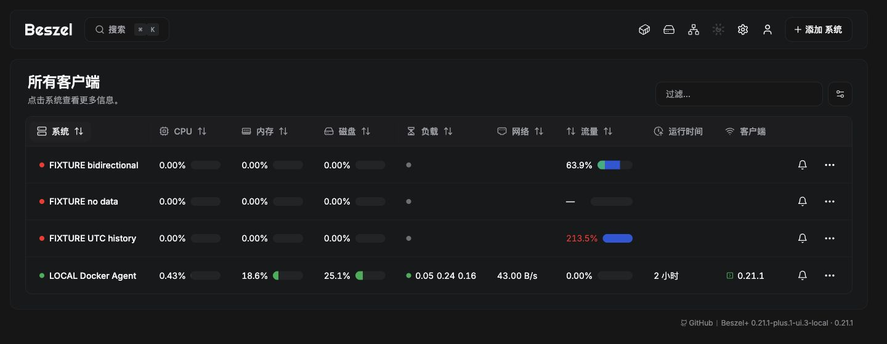

# 流量列紧凑样式

2026-11-06。所有客户端表格/网格视图的列名改为“流量”，保留traffic列ID和已有显示列设置。列顺序由列定义固定，流量紧随磁盘（在GPU和负载之前）；表格、网格、可见列菜单同步采用此顺序。使用与CPU/内存/磁盘相同的单行百分比、数字格式、条高与圆角，按使用百分比排序。具体已用/配额、入站/出站、UTC周期、最近同步、数据质量与故障原因放在悬停提示中，点击仍进入系统详情。

显示当前已配置的计费周期；账单日起始日为1时就是自然月。Rx+Tx计费时绿色/蓝色分别代表入站/出站；仅Tx计费时只绘制蓝色。双色部分按用量构成分配，不能把未计费的Rx填入Tx百分比。超过100%保留真实数字，填充总宽限制100%且保持Rx/Tx比例。无配额/无数据/显示关闭用破折号与空轨道，不伪造0%；真实0仍为0.00%。详情页继续使用完整摘要样式。

已执行前端33项测试、TypeScript/Vite完整构建（退出0），覆盖双向占比、仅出站、超额截断、缺失与0区别。只调整UI展示与排序，不变更Agent/API/账单计算。

此 UI 已随候选版本 `0.21.1-plus.1-candidate.42181555701.1` [发布](https://github.com/CodeAIX/Beszel-Plus/releases/tag/v0.21.1-plus.1-candidate.42181555701.1)，源码 `452a8221545380cdddb9072888e7855d1064a234`。本机 Hub/Agent 已使用公开发布 digest，镜像与验证状态见 [CANDIDATE](CANDIDATE.md)。24 小时观察从本次升级后重新计时，旧观察记录保留。未操作 fnOS/生产 VPS。

浏览器验收：1440px桌面表格与390px窄屏网格；CPU与流量条高同为14px，网格两者可用条宽一致。已验证按百分比排序（213.5%、63.9%、0.00%、无数据），并恢复系统名排序/表格视图。保留原有系统与配额，另加明确标记的双向样例供预览。

首次浏览器验收使用本地预览源码 `364914af010eb60014ba8e4f4e567dc43580e119`，下图保留当时流量列位于网络之后的画面。最终发布源码另包含磁盘后置列顺序调整；[完整发行回归](https://github.com/CodeAIX/Beszel-Plus/actions/runs/42181555701) 全绿，发布后的匿名拉取、补丁回放与本地升级验证通过。当前 24 小时观察开始于 2026-11-06 08:04:26 UTC，尚未完成。

